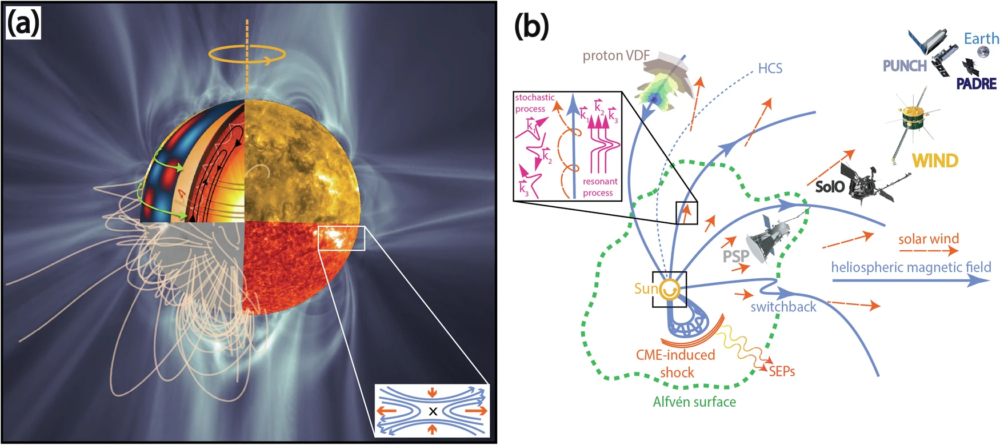

# Heliophysics

Heliophysics is the study of the interconnect Earth-Sun system, specifically studying the plasma physics processes that shape and change the plasma as it propagates from the Sun 
through the solar system and interacts with planetary environments. Check out [NASA's heliophysics page](https://science.nasa.gov/heliophysics/) for additional information
on missions and the field.

*Overview of (a) the solar interior and solar magnetic field and (b) the inner heliosphere. Figure from [Ervin, Nakhleh, and Bharati Das (2026), Nature Communications](https://www.nature.com/articles/s41467-026-72082-8).*

## Solar Monitor

All data is pulled from publicly accessible, online sources. These data and plots are not meant for scientific study, solely visualization in their current form. Extensive work by engineers, instrument scientists, and scientific teams has gone into producing all of these data products.

  
Explore recent observations of the Sun and the solar wind near Earth. The Solar Monitor brings together magnetic maps, extreme ultraviolet images, helioseismic maps of the solar farside, and solar wind measurements. 

  <a class="monitor-link" href="solar-monitor/">Open the Solar Monitor</a>

**Overview of observations:**

- **Photospheric magnetic field.** Compare the ADAPT GONG Carrington map of the radial field with the SDO/HMI full-disk line-of-sight magnetogram. 
- **Solar farside.** View the Stanford JSOC helioseismic composite, which uses acoustic travel-time shifts to identify signatures of active regions on the far side of the Sun.
- **Solar corona.** View full-disk SDO/AIA images at 193 Å and 211 Å.
- **Solar wind at Earth.** Explore the latest available 72 hours of one-minute OMNI solar wind speed, proton density, magnetic field magnitude, and GSM Bz. OMNI times are shifted to Earth’s bow shock nose.

The monitor checks for updates hourly. Each panel shows its own data time or provider update time. OMNI can lag behind the solar images, so check the displayed timestamps when comparing datasets.
