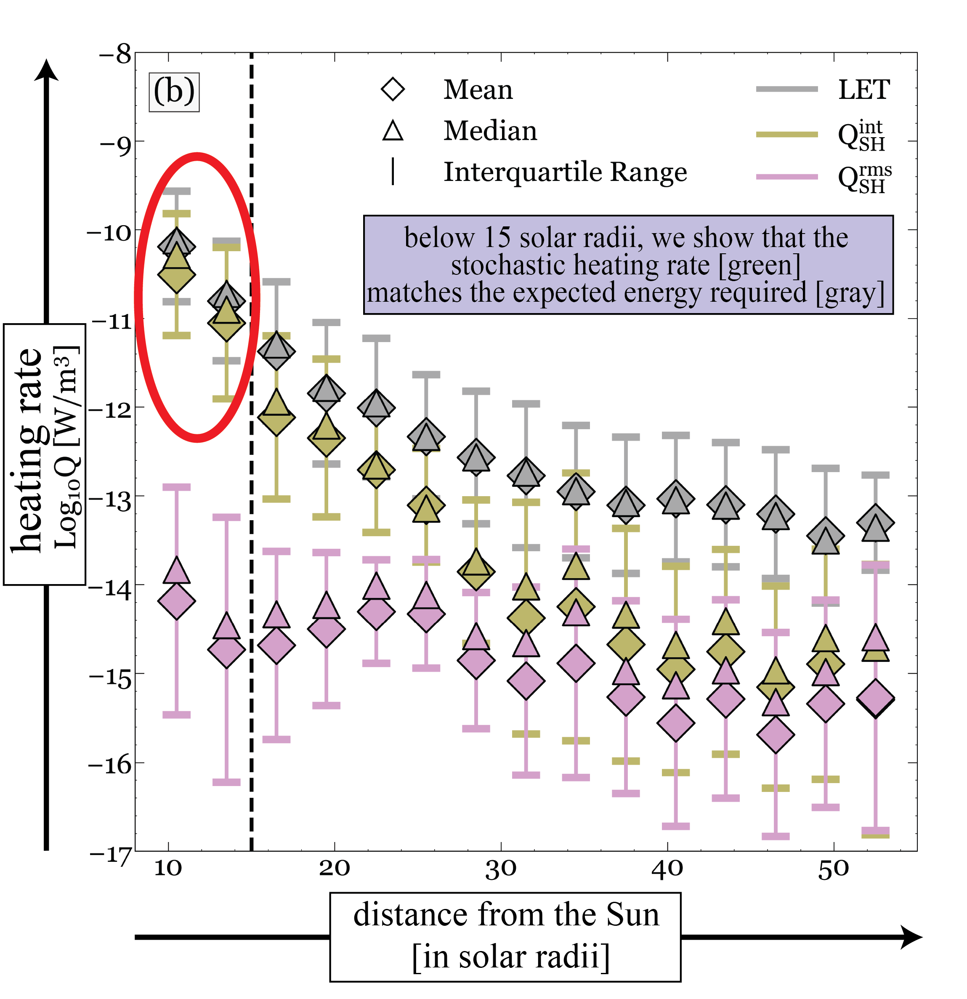
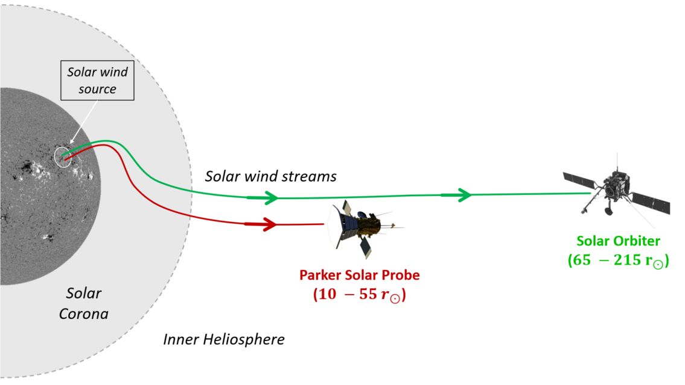
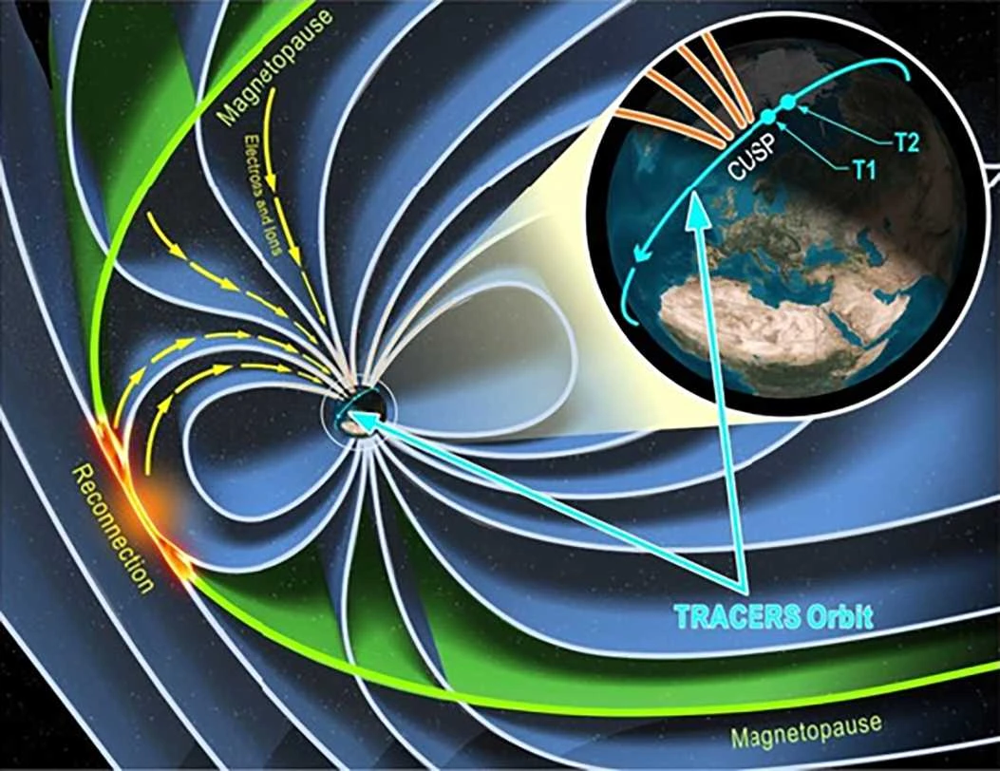

# Research & Publications

My research uses in-situ measurements from spacecraft (Parker Solar Probe, Solar Orbiter, Wind) and sounding rockets (OCHRE)
throughout the heliosphere to constrain fundamental physical processes at work. I am interested in a number of open questions, primarily
surrounding kinetic plasma physics. You can find a full list of publications through my Scholar or ORCID profile.

  <a href="https://scholar.google.com/citations?user=a9dSo5IAAAAJ&amp;hl=en">
    Google Scholar ↗
  </a>
  <a href="https://orcid.org/0000-0002-8475-8606">
    ORCID ↗
  </a>

## How is the outer corona and solar wind heated?

<figure class="research-figure" markdown="1">

<figcaption markdown="span">
*Figure adapted from [Ervin et al. (2026d), Astrophysical Journal Letters](https://arxiv.org/abs/2610.24296).*
</figcaption>

</figure>

A longstanding problem in Heliophysics has been to explain how the Sun's outer atmosphere (the Corona) and the subsequent
solar wind is heated. There are many observational and theoretical studies that have been working on this problem since the 1950's, 
and this is one of the main science goals of the Parker Solar Probe mission. 

**Using Parker Solar Probe observations near the Sun, our recent work has shown that a process called stochastic heating can 
account for the majority of the expected heating in the outer corona and solar wind.** Further from the Sun, resonant interactions
with ion-cyclotron waves can account for the expected energy budget.

On the left we show, a comparison of the expected amount of energy transferred (gray) with the stochastic heating rate (green). We show that in the outer corona, below 15 solar radii, 
that stochastic heating matches the expected energy transfer. 

## Where does the solar wind come from?

<figure class="research-figure" markdown="1">

<figcaption markdown="span">
*Schematic overview of connecting an observed parcel of solar wind plasma to its source. Figure from [Dakeyo, Ervin et al., (2026), Astrophysical Journal](https://iopscience.iop.org/article/10.3847/1538-4357/ae80a4#apjae80a4f1).*
 </figcaption>

</figure>

The fast solar wind has long been known to emerge from coronal hole (cool, low density) regions along open field lines in the solar corona. The wind then continually
accelerates through the inner heliosphere where it is measured in-situ by spacecraft. The slow solar wind however often has different plasma parameters than the fast wind, 
and full understanding of its source(s) and release mechanism(s) is still considered an open problem.

Using a combination of models and multi-spacecraft observations, we have made significant progress towards understanding the source
region of the slow solar wind. **From Parker Solar Probe and Solar Orbiter observations, we show that slow wind typically emerges from the boundaries of coronal hole structures.**

## What mechanism(s) drive outflows of heated ionospheric plasma?

<figure class="research-figure" markdown="1">

<figcaption markdown="span">
*Overview of the Earth's polar cusps and the TRACERS mission trajectory. Figure from [Miles et al. (2025)](https://link.springer.com/article/10.1007/s11214-025-01184-4?fromPaywallRec=false).*
</figcaption>

</figure>

The Observing Cusp High-Altitude Reconnection and Electrodynamics (OCHRE) mission will launch in early 2027 to make in-situ
measurements of particles and fields in the Earth's polar cusp. In this region, plasma of solar origin can directly enter Earth's upper 
atmosphere and there are remaining open questions about how the plasma in this region is heated and outflows. **The OCHRE sounding rocket project 
serves to compliment the The Tandem Reconnection and Cusp Electrodynamics Reconnaissance Satellites (TRACERS) Mission, and
is led by graduate students under the guidance of professional scientists and engineers on the TRACERS missions.**

